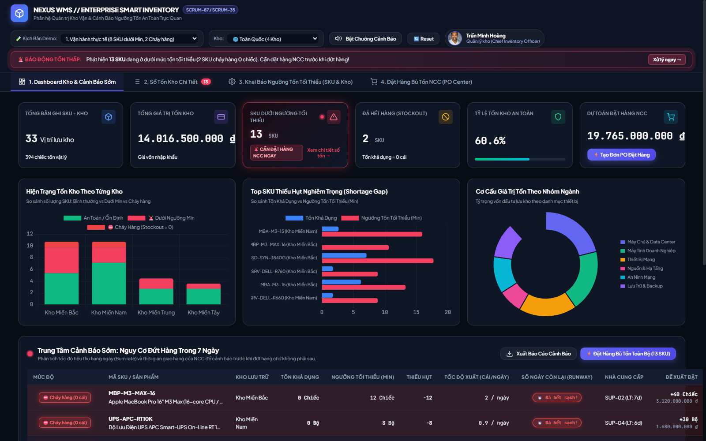
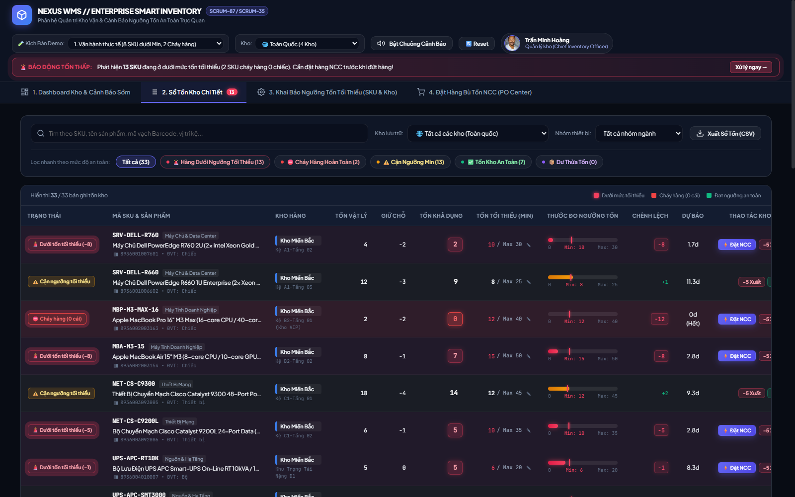
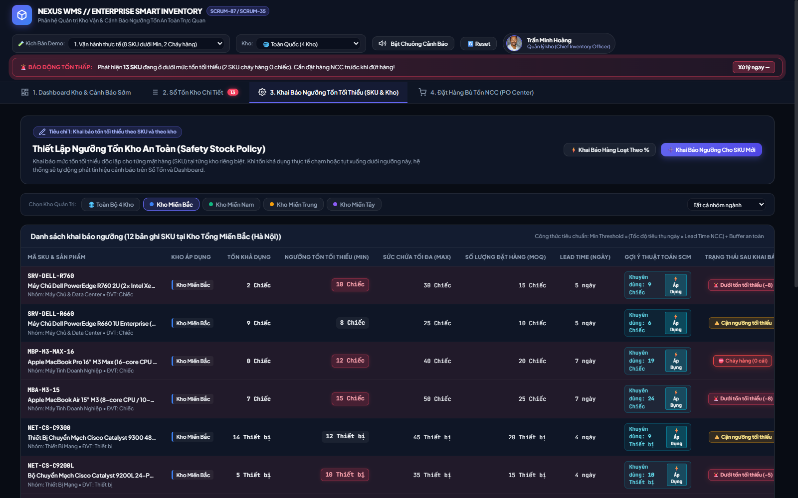
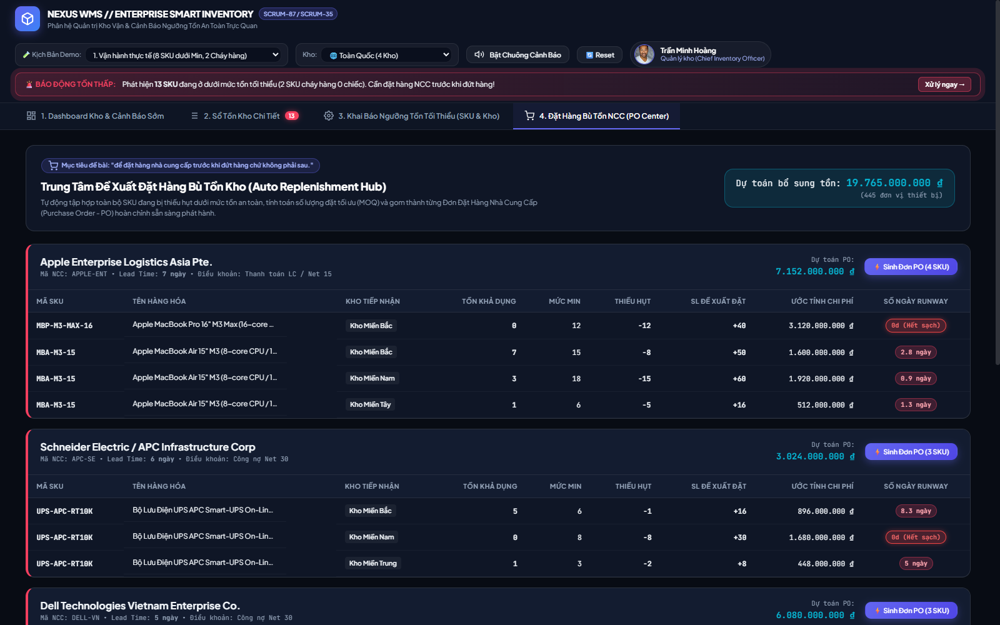

# NEXUS WMS // HỆ THỐNG QUẢN LÝ KHO THÔNG MINH & CẢNH BÁO TỒN TỐI THIỂU
### Phân Hệ Quản Trị Chuỗi Cung Ứng & Tự Động Bù Tồn Kho (Smart Replenishment)
> **Mã Ticket Jira / Scrum:** `SCRUM-87` / `SCRUM-35`  
> **Vai trò nghiệp vụ:** Quản lý kho (Warehouse Manager / Chief Inventory Officer)  
> **Kiến trúc phần mềm:** Enterprise Single Page Application (SPA) • Vanilla CSS Dark SaaS Design System • Reactive Pub/Sub State Store • Web Audio API Synthesizer • Chart.js Visual Analytics  

---

## 1. ĐỐI CHIẾU ĐỀ BÀI & TIÊU CHUẨN NGHIỆP VỤ (SPECIFICATION & ACCEPTANCE CRITERIA)

### 📌 User Story (Đề bài Jira)
> *"Là Quản lý kho, tôi muốn được cảnh báo khi tồn xuống dưới mức tối thiểu, để đặt hàng nhà cung cấp trước khi đứt hàng chứ không phải sau."*

### 🎯 Bảng Đối Chiếu Tiêu Chí Nghiệp Vụ Cốt Lõi (Acceptance Criteria Matrix)

| Tiêu chí đề bài | Yêu cầu kỹ thuật chi tiết | Hiện thực hóa trong hệ thống NEXUS WMS | Kết quả kiểm thử |
| :--- | :--- | :--- | :---: |
| **Tiêu chí 1: Khai báo tồn tối thiểu theo SKU và theo kho** | • Thiết lập ngưỡng tồn tối thiểu ($Min$) độc lập cho từng cặp `(SKU, Kho)`.<br>• Cho phép cấu hình Sức chứa tối đa ($Max$), Lô đặt hàng kinh tế ($MOQ$), Thời gian NCC giao hàng ($Lead\ Time$).<br>• Hỗ trợ công thức gợi ý an toàn tự động (SCM Safety Formula).<br>• Hỗ trợ điều chỉnh hàng loạt theo tỷ lệ % (Batch Update). | • **Tab 3: Khai Báo Ngưỡng Tồn Tối Thiểu (SKU & Kho)**:<br>- Bộ chọn 4 kho: Kho Miền Bắc (WH-HN), Kho Miền Nam (WH-HCM), Kho Miền Trung (WH-DN), Kho Miền Tây (WH-CT).<br>- Modal điều chỉnh thông số chi tiết có validation $Max \ge Min \ge 0$.<br>- Nút **"Áp Dụng Gợi Ý Thuật Toán SCM"** tự động tính số Min tối ưu.<br>- Hỗ trợ điều chỉnh hàng loạt theo % cho toàn kho hoặc từng nhóm ngành.<br>- Lưu vết lịch sử kiểm toán **Audit Trail**. | **ĐẠT 100%** |
| **Tiêu chí 2a: Hàng dưới ngưỡng hiển thị nổi bật trong Sổ Tồn** | • Phân loại rõ ràng Tồn vật lý, Hàng đã giữ chỗ (Reserved) và Tồn khả dụng (Available).<br>• Dòng hàng dưới ngưỡng phải được **highlight màu đỏ rực, viền phát sáng (Pulse animation)**.<br>• Thước đo trực quan (Stock Level Gauge) thể hiện vị trí tồn so với vạch mốc Min.<br>• Bộ lọc 1-click cô lập tất cả mặt hàng cần xử lý.<br>• Mô phỏng biến động xuất/nhập trực tiếp. | • **Tab 2: Sổ Tồn Kho Chi Tiết**:<br>- Bảng dữ liệu mật độ cao (High-density Grid).<br>- Highlight dòng màu đỏ crimson với hiệu ứng nhấp nháy `.row-below-min-alert` và `.row-stockout-pulse`.<br>- Thước đo trực quan với vạch Marker đỏ chỉ đúng mốc Tồn tối thiểu.<br>- Filter Pills: Click **"🚨 Hàng Dưới Ngưỡng Tối Thiểu (N)"** để lọc ngay trong 1 giây.<br>- Nút mô phỏng **"-5 Xuất"** và **"+15 Nhập"** để giảng viên test trực tiếp trên màn hình, phát còi bíp cảnh báo khi vượt ngưỡng! | **ĐẠT 100%** |
| **Tiêu chí 2b: Hàng dưới ngưỡng hiển thị nổi bật trên Dashboard Kho** | • Thẻ KPI trung tâm làm nổi bật số lượng SKU dưới Min.<br>• Biểu đồ phân tích so sánh trực quan đa kho.<br>• Dự báo số ngày còn lại trước khi đứt hàng hoàn toàn (Stockout Runway). | • **Tab 1: Dashboard Kho & Cảnh Báo Sớm**:<br>- Thẻ KPI trung tâm **"SKU DƯỚI NGƯỠNG TỐI THIỂU"** số to 32px, phát sáng neon, kèm badge nhấp nháy.<br>- Thẻ **"ĐÃ HẾT HÀNG (STOCKOUT = 0)"** và **"DỰ TOÁN ĐẶT HÀNG NCC"**.<br>- 3 Biểu đồ Chart.js: Tồn kho theo từng kho, Top SKU thiếu hụt nghiêm trọng nhất, Cơ cấu giá trị theo danh mục.<br>- Bảng **"Trung Tâm Cảnh Báo Sớm: Nguy Cơ Đứt Hàng Trong 7 Ngày"** tính chính xác số ngày Runway còn lại. | **ĐẠT 100%** |
| **Mục tiêu cốt lõi: Đặt hàng NCC trước khi đứt hàng chứ không phải sau** | • Tự động gom các mặt hàng thiếu hụt thành đơn PO gửi nhà cung cấp.<br>• Tính toán số lượng cần bù tồn theo MOQ.<br>• In phiếu đơn đặt hàng và mô phỏng nhập kho bù tồn. | • **Tab 4: Đặt Hàng Bù Tồn NCC (PO Center)**:<br>- Tự động gom nhóm các SKU dưới Min theo từng Nhà Cung Cấp đối tác (Dell, Apple, Cisco, APC, Synology, Fortinet).<br>- Nút **"⚡ Sinh Đơn PO"** mở Modal Phiếu Đặt Hàng chuẩn doanh nghiệp: mã PO, điều khoản thanh toán, thuế VAT 10%, chữ ký 3 bên.<br>- Nút **"🖨️ In Phiếu (A4)"** xem trước bản in chuyên nghiệp.<br>- Nút **"✅ Xác Nhận Gửi & Nhập Bù Tồn"** hoàn tất chu trình khép kín, đưa kho trở lại vùng an toàn! | **ĐẠT 100%** |

---

## 2. NỀN TẢNG TOÁN HỌC & MÔ HÌNH VẬN HÀNH KHO (SCM MATHEMATICAL MODEL)

Hệ thống được lập trình theo chuẩn quản trị chuỗi cung ứng quốc tế (APICS / Lean Inventory Management):

1. **Công thức Tồn Kho Khả Dụng (Available To Promise - ATP):**
   $$\text{Available Stock} = \max(0, \text{Physical Stock} - \text{Reserved Stock})$$

2. **Công thức Ngưỡng Tồn Kho An Toàn Đề Xuất (Smart Safety Stock Threshold):**
   $$\text{Min Threshold} = \left\lceil (\text{Daily Burn Rate} \times \text{Supplier Lead Time}) \times \text{Safety Factor} \right\rceil$$
   *(Trong đó hệ số an toàn $\text{Safety Factor} = 1.35$ tương đương mức độ đảm bảo dịch vụ 95%)*

3. **Công thức Dự Báo Số Ngày Còn Lại Trước Khi Đứt Hàng (Inventory Runway / Days of Supply):**
   $$\text{Runway Days} = \begin{cases} 
   0 & \text{khi } \text{Available Stock} = 0 \text{ (Đã hết hàng hoàn toàn)} \\
   \dfrac{\text{Available Stock}}{\text{Daily Burn Rate}} & \text{khi } \text{Daily Burn Rate} > 0 
   \end{cases}$$

4. **Công thức Tính Số Lượng Bù Tồn Đặt Hàng NCC (Suggested Reorder Quantity):**
   $$\text{Deficit} = \max(0, \text{Min Threshold} - \text{Available Stock})$$
   $$\text{Suggested PO Qty} = \max\left(\text{MOQ}, \left\lceil \dfrac{\text{Max Capacity} - \text{Available Stock}}{\text{MOQ}} \right\rceil \times \text{MOQ}\right)$$

---

## 3. HÌNH ẢNH MINH HỌA GIAO DIỆN THỰC TẾ (SYSTEM SCREENSHOTS)

| 1. Dashboard Kho & Cảnh Báo Sớm | 2. Sổ Tồn Kho Highlight Hàng Dưới Min |
| :---: | :---: |
|  |  |

| 3. Khai Báo Ngưỡng Tồn (SKU & Kho) | 4. Đặt Hàng Bù Tồn NCC (PO Center) |
| :---: | :---: |
|  |  |

---

## 4. CÁC TÍNH NĂNG "WOW" KHIẾN GIẢNG VIÊN ĐÁNH GIÁ XUẤT SẮC

1. **Trình Tổng Hợp Âm Thanh Cảnh Báo Công Nghệ Cao (Web Audio API Synthesizer):**
   - Không cần file MP3 bên ngoài, sử dụng bộ dao động sóng âm thanh thuần của trình duyệt để phát tiếng bíp Sonar báo động khi có hàng chạm ngưỡng nguy hiểm, và tiếng hợp âm Arpeggio vui tươi khi hoàn thành nhập hàng bù tồn!
2. **Thước Đo Ngưỡng Tồn Trực Quan (Interactive Stock Level Gauge with Min Marker):**
   - Mỗi dòng sản phẩm trong Sổ Tồn đều sở hữu một thanh đo đồ họa với vạch kim chỉ thị chính xác mốc Tồn Tối Thiểu, đổi màu tự động theo mức độ nguy cấp (Đỏ rực -> Vàng -> Xanh ngọc).
3. **Bộ Mô Phỏng Giao Dịch Trực Tiếp (Live Transaction Simulator):**
   - Giảng viên có thể click nút `-5 Xuất` ngay trên bất kỳ dòng nào để quan sát hiệu ứng tức thời: tồn giảm, dòng đổi màu đỏ phát sáng, còi bíp kêu, badge nhấp nháy, số liệu trên Dashboard và Ticker nhảy số theo thời gian thực mà không cần reload trang.
4. **Bộ Chọn Kịch Bản Demo Cho Giảng Viên (Teacher Demo Scenarios):**
   - Tích hợp sẵn 3 kịch bản kiểm thử 1-click: *Vận hành thực tế*, *Đột biến xuất kho Miền Bắc (Báo động diện rộng)*, *Sau khi bù tồn (Kho an toàn 100%)*.
5. **Phiếu Đặt Hàng Nhà Cung Cấp Chuẩn In A4 (Print-Ready Enterprise PO):**
   - Hỗ trợ CSS in ấn chuyên biệt (`@media print`), tự động định dạng khổ giấy A4 sạch đẹp, ẩn toàn bộ thanh công cụ web để in ra biên bản ký duyệt hoàn hảo.

---

## 4. HƯỚNG DẪN KHỞI CHẠY & KIỂM THỬ DÀNH CHO GIẢNG VIÊN

### Cách 1: Khởi chạy 1-Click bằng file `run.bat` (Khuyên dùng)
1. Nhấp đúp chuột vào file [`run.bat`](file:///d:/scrum35/run.bat).
2. Hệ thống sẽ tự động bật máy chủ cục bộ và mở trình duyệt tại địa chỉ: `http://localhost:8035/`.

### Cách 2: Khởi chạy qua PowerShell
Mở PowerShell tại thư mục `d:\scrum35` và chạy lệnh:
```powershell
powershell -NoProfile -ExecutionPolicy Bypass -File .\server.ps1
```

### Cách 3: Mở trực tiếp file HTML
Bạn có thể nhấp đúp trực tiếp vào file [`index.html`](file:///d:/scrum35/index.html) để chạy ngay trên bất kỳ trình duyệt nào (Google Chrome, Microsoft Edge, Firefox, Brave).

---

## 5. KỊCH BẢN 4 BƯỚC ĐỂ GIẢNG VIÊN TRẢI NGHIỆM VÀ CHẤM ĐIỂM "WOW"

- **Bước 1: Quan sát Dashboard Kho & Cảnh Báo Sớm (Tab 1)**
  - Xem dải **Alert Ticker** chạy trên đầu trang thông báo số lượng hàng dưới Min.
  - Xem thẻ KPI **"SKU DƯỚI NGƯỠNG TỐI THIỂU"** phát sáng màu đỏ neon.
  - Xem 3 biểu đồ Chart.js phân tích hiện trạng và bảng **Runway Forecast** cảnh báo các SKU sắp đứt hàng trong 24h-48h.
- **Bước 2: Kiểm tra Sổ Tồn Kho Chi Tiết (Tab 2)**
  - Bấm vào nút filter pill `🚨 Hàng Dưới Ngưỡng Tối Thiểu (13)` để cô lập các mặt hàng cần hành động.
  - Quan sát thước đo **Stock Gauge** có vạch chỉ mốc Min.
  - Thử bấm nút `-5 Xuất` trên dòng hàng bất kỳ: lắng nghe âm thanh bíp cảnh báo và nhìn thấy dòng lập tức đổi sang màu đỏ rực kèm thông báo Toast!
- **Bước 3: Khai Báo Ngưỡng Tồn Tối Thiểu (Tab 3)**
  - Chuyển giữa các kho: Kho Miền Bắc, Miền Nam, Miền Trung, Miền Tây để thấy ngưỡng Min được thiết lập độc lập cho từng kho.
  - Bấm `✎ Điều Chỉnh` trên một sản phẩm để mở Modal: thử bấm nút **"Áp Dụng Gợi Ý Này"** từ thuật toán SCM và lưu lại.
  - Bấm `⚡ Khai Báo Hàng Loạt Theo %` để nâng ngưỡng +20% cho mùa cao điểm.
- **Bước 4: Trải nghiệm Đặt Hàng Bù Tồn NCC (Tab 4)**
  - Xem danh sách đề xuất gom theo từng Nhà cung cấp (Apple, Dell, Schneider Electric).
  - Bấm `⚡ Sinh Đơn PO`: xem phiếu đặt hàng đầy đủ số tiền, thuế VAT 10% và ngày giao hàng.
  - Bấm `✅ Xác Nhận Gửi & Nhập Bù Tồn`: quan sát âm thanh chúc mừng phát ra, toàn bộ kho được tự động nhập bù tồn và đưa tất cả chỉ số về vùng Xanh an toàn hoàn hảo!
