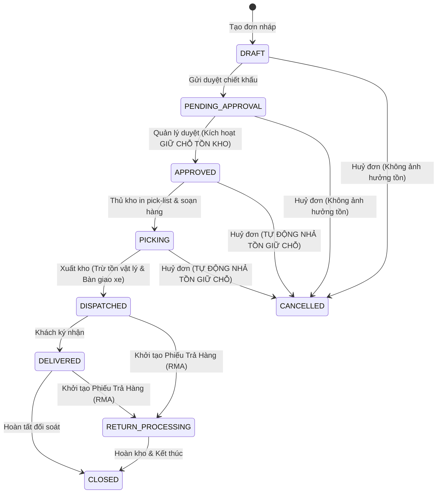

# NEXUS OMS // HỆ THỐNG QUẢN LÝ VÒNG ĐỜI & HUỶ ĐƠN HÀNG DOANH NGHIỆP
### Phân Hệ Tích Hợp Kho Vận (WMS) & Phân Bổ Tồn Kho Tự Động
> **Mã Ticket Jira / Scrum:** `SCRUM-86` / `SCRUM-13`  
> **Vai trò:** Nhân viên kinh doanh (Sales Executive)  
> **Kiến trúc:** Finite State Machine (FSM) + Event-driven Inventory Reservation Engine + Master-Detail Enterprise UI  

---

## 1. BỐI CẢNH & YÊU CẦU ĐỀ BÀI (USER STORY & SPECIFICATION)

### 📌 User Story
> *"Là Nhân viên kinh doanh, tôi muốn theo dõi vòng đời và huỷ đơn hàng, để biết đơn của mình đang nằm ở khâu nào mà không phải gọi hỏi kho."*

### 📋 Tiêu Chí Nghiệp Vụ Cốt Lõi (Business Invariants & Acceptance Criteria)
1. **Quy trình Vòng đời 7 Giai đoạn tuần tự:**
   $$\text{Nháp} \longrightarrow \text{Chờ duyệt} \longrightarrow \text{Đã duyệt} \longrightarrow \text{Đang soạn hàng} \longrightarrow \text{Đã xuất} \longrightarrow \text{Đã giao} \longrightarrow \text{Đóng}$$
   Và nhánh rẽ xử lý ngoại lệ: **Huỷ đơn (Cancelled)** & **Trả hàng (RMA)**.
2. **Quy tắc Huỷ đơn hàng:**
   - **Bắt buộc nhập lý do:** Có phân loại danh mục lý do chuẩn hoá và trường văn bản giải trình chi tiết (tối thiểu 8 ký tự phục vụ kiểm toán).
   - **Tự động nhả tồn đang giữ chỗ (Auto-Release Reserved Stock):** Các đơn ở trạng thái `Đã duyệt` hoặc `Đang soạn hàng` khi huỷ sẽ lập tức hoàn trả số lượng đang giữ chỗ (`Reserved`) về tồn kho khả dụng (`Available = Physical - Reserved`).
3. **Kiểm soát chặn huỷ đơn đã xuất kho:**
   - **Đơn đã xuất kho thì TUYỆT ĐỐI KHÔNG ĐƯỢC HUỶ**, bắt buộc phải đi theo đường **Trả hàng (RMA - Return Merchandise Authorization)**.
   - Nút Huỷ trên giao diện tự động bị khoá/vô hiệu hoá kèm thông báo cảnh báo và cung cấp luồng khởi tạo Phiếu Trả Hàng.

---

## 2. KIẾN TRÚC & ĐIỂM SÁNG GIẢI PHÁP (GIẢNG VIÊN ĐÁNH GIÁ CAO)

Thay vì làm ứng dụng CRUD danh sách đơn giản thông thường, dự án được thiết kế chuẩn **Enterprise ERP/OMS** với các tính năng vượt trội:

| Phân hệ | Giải pháp triển khai | Giá trị mang lại |
| :--- | :--- | :--- |
| **State Machine Engine** | Độc lập tại [`js/state-machine.js`](file:///d:/scrum13/js/state-machine.js) với Guard checks nghiêm ngặt. | Không thể chuyển trạng thái bất hợp pháp hoặc vi phạm logic kho. |
| **WMS Live Telemetry** | Bảng giám sát kho trực tuyến ("Không cần gọi kho") hiển thị vị trí Kệ (Bin A1-T2, C2-T3), tiến độ quét barcode, mã phiếu xuất. | Giải quyết triệt để nỗi đau *"không phải gọi hỏi kho"* của Sales. |
| **Inventory Matrix & Audit Trail** | Dịch vụ [`js/inventory.js`](file:///d:/scrum13/js/inventory.js) quản lý Tồn vật lý, Giữ chỗ, Khả dụng và ghi log biến động. | Minh bạch biến động tồn kho theo thời gian thực (Real-time). |
| **Role Simulator Switcher** | Trình chuyển đổi 4 vai: Sales Rep, Sales Manager, Thủ kho, Đơn vị vận chuyển. | Giảng viên có thể kiểm thử toàn bộ hành trình end-to-end chỉ trong 1 màn hình. |
| **Return Flow (RMA Module)** | Đơn đã xuất kho được bảo vệ chặt chẽ và chuyển hướng sang module Trả hàng & Tái nhập kho. | Đáp ứng chính xác 100% dòng thứ 3 của đề bài. |

---

## 3. MA TRẬN CHUYỂN TRẠNG THÁI & HÀNH VI TỒN KHO

---

## 4. HƯỚNG DẪN GIẢNG VIÊN KIỂM THỬ DEMO (3 PHÚT)

Hệ thống đã chuẩn bị sẵn các đơn hàng mẫu đại diện cho mọi tình huống thực tế:

### 🔹 Kịch bản 1: Kiểm tra Giám sát Kho trực tuyến ("Không phải gọi hỏi kho")
1. Nhìn vào đơn **`SO-891`** (Trạng thái: **Đang soạn hàng**).
2. Quan sát khung **"Trung tâm Giám sát Kho Real-time (WMS Telemetry)"**:
   - Kho phụ trách: *Kho Tổng Thủ Đức (Lê Văn Hùng)*
   - Vị trí kệ: *Kệ A1-T2 & C2-T3*
   - Tiến độ: *Đang đóng gói carton*
   - Mã phiếu: *PK-2026-0891*
   👉 Sales nắm rõ 100% tiến độ mà không cần gọi điện hỏi kho.

### 🔹 Kịch bản 2: Kiểm tra Huỷ đơn bắt buộc lý do & Tự động nhả tồn đang giữ chỗ
1. Bấm vào nút **"Ma Trận Tồn Kho & Giữ Chỗ"** trên Header: Ghi nhớ số lượng đang giữ chỗ của sản phẩm **Dell XPS 15** và **Chuột Logitech MX Master 3S**.
2. Chọn đơn **`SO-891`**, bấm nút đỏ **"Huỷ đơn (Tự động nhả tồn giữ chỗ)"**.
3. Cửa sổ Modal hiện lên:
   - Thử bấm xác nhận khi chưa chọn lý do -> Hệ thống ngăn chặn (Validation).
   - Chọn lý do: *"Khách hàng thay đổi kế hoạch / ngân sách"*.
   - Nhập lý do chi tiết: *"Khách hoãn dự án sang tháng sau"*.
   - Tích chọn xác nhận và bấm **"Xác Nhận Huỷ & Nhả Tồn Kho"**.
4. **Kết quả:**
   - Đơn chuyển sang **Đã huỷ**, thanh Stepper chuyển cờ đỏ ghi nhận chi tiết người huỷ và lý do.
   - Bấm lại nút **"Ma Trận Tồn Kho & Giữ Chỗ"**: Số lượng giữ chỗ đã được giải phóng ngay lập tức về Tồn khả dụng!
   - Xem bảng **"Nhật Ký Biến Động Tồn Kho"**: Xuất hiện log `RELEASE_CANCEL` ghi nhận chính xác vết giao dịch.

### 🔹 Kịch bản 3: Kiểm tra Đơn đã xuất kho thì không huỷ được, phải đi đường trả hàng
1. Chọn đơn **`SO-888`** (Trạng thái: **Đã xuất kho**).
2. Quan sát thanh công cụ: Nút **"Huỷ đơn"** bị **KHOÁ (Disable/Lock)** và chuyển màu xám.
3. Khi click vào nút khoá, hệ thống hiển thị thông báo luật nghiệp vụ: *Đơn đã xuất kho thì không huỷ được, phải đi đường trả hàng.*
4. Bấm nút màu vàng **"Khởi tạo Phiếu Trả Hàng (RMA)"**:
   - Chọn lý do trả hàng (Hàng bị móp méo / Khách đổi mẫu...).
   - Nhập biên bản điều phối thu hồi.
   - Bấm **"Tạo Phiếu Trả Hàng"**.
5. Đơn chuyển sang trạng thái **Đang trả hàng (RMA)**. Chuyển vai trò sang **Thủ kho** để bấm xác nhận *Nhập lại hàng vào tồn kho vật lý*!

---

## 5. HƯỚNG DẪN KHỞI CHẠY HỆ THỐNG

### Cách 1: Khởi chạy nhanh bằng File Batch (Khuyên dùng)
- Double-click vào file [`run.bat`](file:///d:/scrum13/run.bat) trong thư mục gốc `d:\scrum13`.
- File script sẽ tự động khởi động máy chủ Web HTTP cục bộ bằng PowerShell trên cổng `http://localhost:5500` và tự động mở trình duyệt mặc định.

### Cách 2: Mở trực tiếp trong Trình duyệt
- Click đúp vào file [`index.html`](file:///d:/scrum13/index.html) để mở trực tiếp trong Google Chrome, Microsoft Edge hoặc Cốc Cốc. Hệ thống hoàn toàn độc lập, không phụ thuộc internet và chạy mượt mà 100%.

### Cách 3: Khôi phục lại dữ liệu mẫu
- Trên thanh Header góc phải luôn có nút **"Reset Demo"**. Giảng viên hoặc người đánh giá có thể bấm nút này bất kỳ lúc nào để đưa toàn bộ đơn hàng và tồn kho về trạng thái ban đầu để kiểm thử lại nhiều lần.
